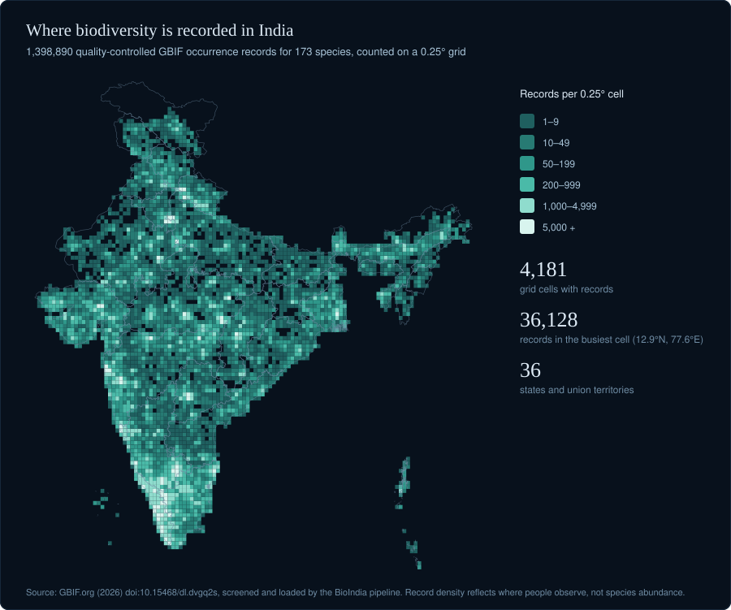
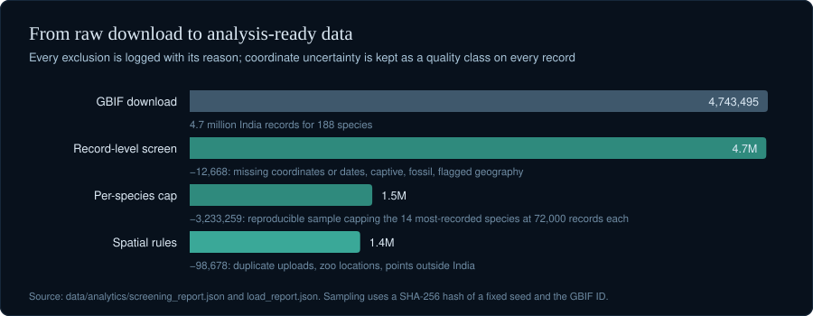
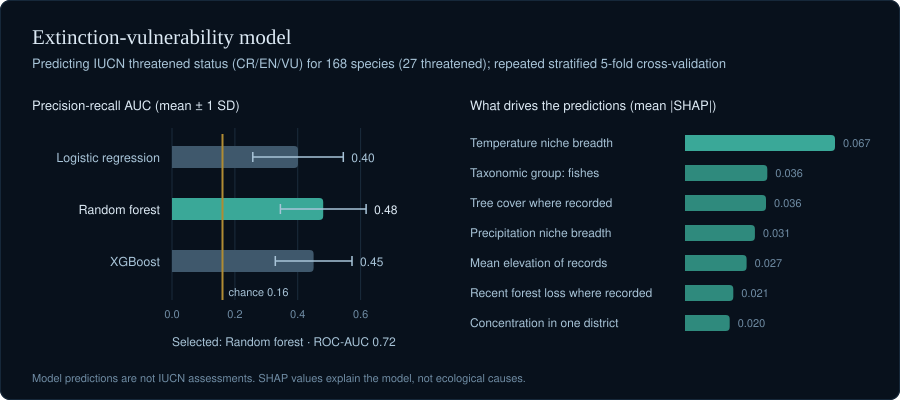
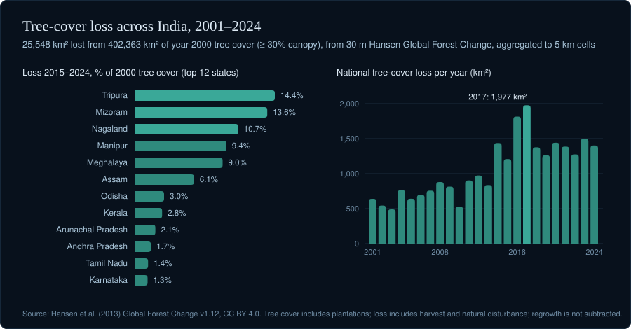
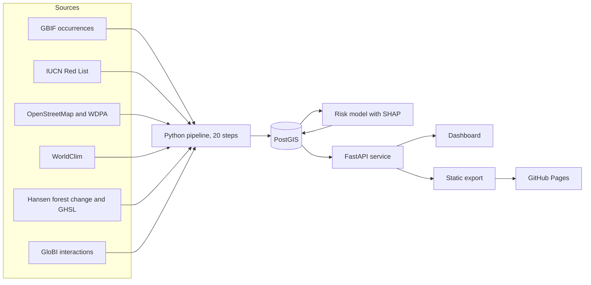

<div align="center">

# BioIndia

**A biodiversity intelligence platform for India**

Extinction-risk modelling · spatio-temporal analysis · conservation prioritisation · ecological cascade simulation

[**Open the live dashboard →**](https://deepaksharma0801.github.io/bioindia/)
&nbsp;&nbsp;·&nbsp;&nbsp;
[Methods and limitations](docs/METHODS.md)
&nbsp;&nbsp;·&nbsp;&nbsp;
[Run it locally](#running-the-platform)

<br>

*"In every walk with nature, one receives far more than he seeks.
The clearest way into the Universe is through a wild forest."*
<br>— John Muir

</div>

<br>

## Overview

India holds four of the world's 36 biodiversity hotspots, yet the evidence needed to judge which
species are declining, where, and why is scattered across occurrence archives, Red List assessments,
protected-area registers, climate grids and satellite forest records. BioIndia brings these sources
into a single spatial database and asks three questions of them:

1. **Where is biodiversity recorded,** and how well is it covered by protected areas?
2. **Which species may be at risk,** including those without a current assessment?
3. **What could follow if a species is lost,** given the interactions documented for it?

Every figure in the platform is computed from cited sources, and every output carries its standing:
observed data, official assessment, derived metric, model prediction, scenario simulation or
experimental index.

<div align="center">

| 188 | 1,398,890 | 36 | 118,686 | 13,469 |
|:---:|:---:|:---:|:---:|:---:|
| India-native species | quality-controlled records | states and union territories | 5 km land-use cells | documented species interactions |

</div>

<br>

## Where biodiversity is recorded

<p align="center"></p>

Records concentrate in the Western Ghats, the south and around major cities, a pattern that reflects
where people observe as much as where species live. Analyses that depend on location use only records
placed within 10 km, and report how many records were left out.

## From raw download to analysis-ready data

<p align="center"></p>

The pipeline screens records for missing or implausible coordinates and dates, captive and fossil
specimens and flagged geography; caps the most-recorded species with a reproducible hashed sample;
then removes duplicate uploads, zoo locations and points outside India in PostGIS. Each exclusion is
logged with its reason.

## Which species may be at risk

<p align="center"></p>

A random forest, selected over logistic regression and gradient boosting by repeated cross-validation,
estimates the probability that a species is threatened from its recorded range, climate niche,
protection and land-use context. It reaches a PR-AUC of 0.48 against a chance level of 0.16. Features
that would leak the answer, such as location precision, which publishers deliberately blur for
threatened species, are excluded. Predictions are explained with SHAP and are never presented as Red
List assessments.

## Pressure on habitats

<p align="center"></p>

Thirty-metre forest-change data and settlement layers are summarised to 5 km cells and joined to the
places each species is recorded. Recent loss, relative to year-2000 cover, is highest in the north-eastern states. Because tree cover
includes plantations and loss includes harvest cycles, these figures measure pressure on places rather
than the destruction of natural forest.

## What the dashboard offers

| Section | Purpose |
|---|---|
| GIS atlas | Every record by species, state, year and location accuracy, with obscured points marked |
| Concentration zones | Grid cells where records concentrate, with protected-area cover |
| Risk and explainability | Model-predicted vulnerability for unassessed species, with per-species SHAP explanations |
| Species intelligence | Profiles of five flagship species: records, distribution, protection, trends and model risk |
| Trends | Records per year since 2000, read as a recording-effort index |
| Climate and land use | Temperature, rainfall, elevation, tree cover, forest loss and built-up land where species occur |
| Cascade simulator | Removes a species and traces which dependent taxa could follow, with sensitivity to the threshold |
| Regional reports | A data-derived report for any state, with the evidence behind every statement |

The hosted dashboard is a static snapshot; the full platform runs locally against the live API.

## Architecture



| Layer | Implementation |
|---|---|
| Dashboard | Static HTML and JavaScript with Leaflet; reads the API or a static snapshot |
| Service | FastAPI with Alembic migrations; more than 40 endpoints |
| Database | PostgreSQL 16 with PostGIS 3.4 |
| Analysis | pandas, GeoPandas, rasterio, scikit-learn, XGBoost, SHAP, NetworkX |
| Delivery | Docker Compose with nginx; a static export for GitHub Pages |
| Quality | 106 automated tests across the API and the data-quality rules |

## Running the platform

```bash
docker compose --profile app up -d --build
```

The dashboard is then served at `http://localhost:8080`, with interactive API documentation at
`/docs`. The database is populated by the pipeline described below.

<details>
<summary><strong>Full setup and data pipeline</strong></summary>

<br>

Requires Python 3.12 or later (results were produced with 3.14.3), Docker Desktop and about 12 GB of
disk space.

```bash
python -m venv .venv
.venv/Scripts/python -m pip install -r requirements-pipeline.txt
docker compose up -d postgis
.venv/Scripts/python scripts/run_pipeline.py
```

`run_pipeline.py --list` shows the twenty steps and `--from <step>` resumes part-way.
`requirements-lock.txt` pins the exact package versions behind the reported results. Sampling,
cross-validation and index sensitivity use fixed seeds.

For development, run the service and dashboard separately:

```bash
.venv/Scripts/python -m uvicorn app.main:app --app-dir backend --port 8000
.venv/Scripts/python -m http.server 5500
```

Regenerate the figures in this document and the static snapshot with:

```bash
.venv/Scripts/python scripts/make_readme_figures.py
.venv/Scripts/python scripts/export_static_site.py
```

</details>

<details>
<summary><strong>Data sources and licences</strong></summary>

<br>

| Source | Use | Terms |
|---|---|---|
| GBIF occurrence download, [doi:10.15468/dl.dvgq2s](https://doi.org/10.15468/dl.dvgq2s) | Species records | CC0, CC BY and CC BY-NC by dataset |
| IUCN Red List (export of 21 October 2026) | Official categories, model labels | Non-commercial research; no redistribution |
| OpenStreetMap, Geofabrik India extract | Wildlife protected areas, tiger reserves | ODbL 1.0 |
| WDPA, October 2026 | Reserved forests, other designations | Non-commercial; no redistribution |
| WorldClim 2.1 | Climate normals, elevation | Fick and Hijmans (2017) |
| Hansen Global Forest Change 2000–2024, v1.12 | Tree cover and loss | CC BY 4.0 |
| GHSL R2023A | Built-up surface, population | CC BY 4.0 |
| geoBoundaries | State boundaries | CC BY 2.5 IN |
| Natural Earth | Neighbouring countries | Public domain |
| GloBI | Documented species interactions | Per-source licences |

Raw data, Red List and WDPA files and trained models are not distributed with this repository. The
public dashboard withholds Red List categories drawn from the IUCN export.

</details>

<details>
<summary><strong>API reference</strong></summary>

<br>

All routes are under `/api/v1`.

| Area | Routes |
|---|---|
| Species | `/species`, `/species/search`, `/species/{id}`, with `/occurrences`, `/trend`, `/intelligence`, `/conservation`, `/environment`, `/land-pressure`, `/protection` |
| Map | `/map/occurrences`, `/map/hotspots`, `/gis/state-boundaries` |
| Analytics | `/analytics/hotspots`, `/analytics/conservation-priority`, `/analytics/threatened-species`, `/analytics/biodiversity-trends` |
| Land use | `/land-use/states`, `/land-use/states/{state}` |
| Network | `/network/species/{id}`, `/network/ecosystem/{region}` |
| Model | `/prediction/ranking`, `/prediction/species/{id}/explanation`, `/model-info`, `/model-performance` |
| Scenarios | `POST /simulation/extinction-cascade` |
| Indices | `/indices/ibvci`, `/indices/cipi`, with configurable weights |
| Reports | `POST /reports/regional` |

</details>

<details>
<summary><strong>Tests</strong></summary>

<br>

```bash
cd backend && ../.venv/Scripts/python -m pytest -q
.venv/Scripts/python -m pytest -q scripts/tests
```

Service tests run against the loaded database and skip any stage that has not been built; the
data-quality tests need no data.

</details>

## Interpreting the results

- **Records are not populations.** Occurrence counts show where people observe, not how many
  individuals exist; missing records do not imply absence.
- **Model output is not an assessment.** The risk model is trained on 168 species and its
  probabilities are better read as rankings than as calibrated chances.
- **Concentration zones are not hotspots** in the recognised conservation sense.
- **Tree cover is not natural forest.** Plantations are included, and loss includes harvest and
  natural disturbance.
- **Cascades are scenarios.** They rest on documented interactions, which are incomplete and favour
  well-studied taxa.
- **Five flagship categories are unverified;** the IUCN export used here does not include them.

The full account of methods, quality rules and limitations is in [docs/METHODS.md](docs/METHODS.md).

<br>

---

<sub>Occurrence data: GBIF.org (2026), GBIF Occurrence Download, https://doi.org/10.15468/dl.dvgq2s.
Forest change: Hansen et al. (2013), *Science* 342, 850–853. Settlements: European Commission JRC,
GHSL R2023A. Climate: Fick and Hijmans (2017). Protected areas: © OpenStreetMap contributors (ODbL)
and UNEP-WCMC and IUCN, Protected Planet. Interactions: Global Biotic Interactions (GloBI).</sub>
