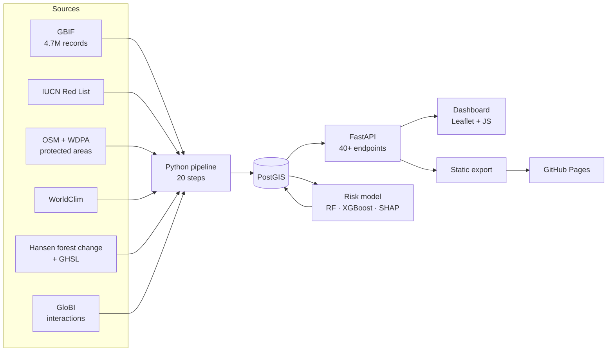

<div align="center">

# 🐅 BioIndia

### A digital twin of India's biodiversity

*Extinction-risk modelling · spatio-temporal analysis · conservation prioritisation · ecological cascade simulation*

<br>

[](https://deepaksharma0801.github.io/bioindia/)


<br>

> *"In every walk with nature, one receives far more than he seeks.<br>The clearest way into the Universe is through a wild forest."*<br>
> — **John Muir**, naturalist

</div>

---

## ✨ What it is

BioIndia is an MSc research platform that brings India's biodiversity data into one place and asks
three questions of it: **where are species recorded, which ones may be at risk, and what could happen
if they disappear?** It joins 1.4 million GBIF occurrence records with IUCN assessments, protected
areas, climate, forest change and documented species interactions, and every number on the dashboard
can be traced back to its source.

<div align="center">

| 🦋 **188** | 📍 **1,398,890** | 🗺️ **36** | 🌳 **118,686** | 🕸️ **13,469** |
|:---:|:---:|:---:|:---:|:---:|
| India-native species | quality-controlled records | states & UTs | 5 km land-use cells | documented interactions |

</div>

## 🧭 Explore the dashboard

| Section | What you can do |
|---|---|
| 🗺️ **GIS Atlas** | Map every record by species, state, year and location accuracy (obscured points are marked) |
| 🔥 **Hotspots** | Find the 0.75° grid cells where records concentrate, with protected-area cover |
| 🤖 **AI Risk** | See which species a machine-learning model rates as likely threatened, and why |
| 🔍 **Explainable AI** | SHAP explanations for every prediction, globally and per species |
| 🐘 **Species Intelligence** | Profiles of the five flagships: records, states, protection, trends, model risk |
| 📈 **Trends** | Records per year since 2000, as a recording-effort index |
| 🌦️ **Climate & land use** | Temperature, rainfall, elevation, tree cover, forest loss and built-up land where species live |
| 🕸️ **Cascade** | Remove a species and simulate which dependent species could follow |
| 📄 **Reports** | Generate a data-backed biodiversity report for any state |

> The hosted site is a static snapshot. Run the stack locally (below) for the live API.

## 🏗️ How it fits together



| Layer | Where | Highlights |
|---|---|---|
| **Dashboard** | `BioIndia_v3_Complete.html`, `bioindia-phase*.js` | Static HTML/JS + Leaflet; live API or static snapshot |
| **API** | `backend/app/` | FastAPI, Alembic migrations, 106 tests |
| **Database** | PostGIS 3.4 in Docker | Occurrences, assessments, protected areas, grids, interactions, model registry, land use |
| **Pipeline** | `scripts/`, run by `scripts/run_pipeline.py` | Reproducible, seeded, every step writes a report |

## 🔬 Science first

Every output is labelled for what it is, so a prediction is never mistaken for a fact:

| Label | Meaning |
|---|---|
| **Observed data** | GBIF records, protected areas, climate and land-use rasters as published |
| **Official assessment** | IUCN Red List category, imported with provenance |
| **MODEL PREDICTION** | Output of the extinction-vulnerability model, never an IUCN status |
| **SCENARIO SIMULATION** | Cascade output under stated assumptions, never a forecast |
| **EXPERIMENTAL RESEARCH METRIC** | The IBVCI and CIPI indices developed in this project |

**The risk model** is a random forest chosen over logistic regression and XGBoost by repeated
cross-validation: PR-AUC **0.48 ± 0.14** against a chance level of 0.16, ROC-AUC 0.72, trained on 168
species. Features that would leak the answer (such as location precision, which publishers blur for
threatened species) are deliberately excluded. Full methods, every quality rule and all limitations
are in **[docs/METHODS.md](docs/METHODS.md)**.

## 🚀 Quick start

```bash
docker compose --profile app up -d --build
```

Then open **http://localhost:8080** (API docs at http://localhost:8080/docs). The database must first
be filled by the pipeline.

<details>
<summary><b>🛠️ Full setup and pipeline</b></summary>

<br>

Needs Python 3.12+ (results produced with 3.14.3) and Docker Desktop, plus about 12 GB of disk.

```bash
python -m venv .venv
.venv/Scripts/python -m pip install -r requirements-pipeline.txt
docker compose up -d postgis
.venv/Scripts/python scripts/run_pipeline.py          # --list shows the 20 steps, --from <step> resumes
```

`requirements-lock.txt` pins the exact versions behind the reported results.

For development, run the API and dashboard separately:

```bash
.venv/Scripts/python -m uvicorn app.main:app --app-dir backend --port 8000
.venv/Scripts/python -m http.server 5500              # open http://127.0.0.1:5500/BioIndia_v3_Complete.html
```

To rebuild the GitHub Pages snapshot:

```bash
.venv/Scripts/python scripts/export_static_site.py    # writes site/, published on the gh-pages branch
```

</details>

<details>
<summary><b>📚 Data sources and licences</b></summary>

<br>

| Source | Licence / terms |
|---|---|
| GBIF occurrence download [10.15468/dl.dvgq2s](https://doi.org/10.15468/dl.dvgq2s) | Mixed CC0 / CC BY / CC BY-NC |
| IUCN Red List export (2026-10-21) | Non-commercial research; no redistribution |
| OpenStreetMap India (Geofabrik) | ODbL 1.0 |
| WDPA India (Oct 2026) | Non-commercial; no redistribution |
| WorldClim 2.1 | Fick & Hijmans (2017) |
| Hansen Global Forest Change 2000–2024 v1.12 | CC BY 4.0 |
| GHSL R2023A built-up and population | CC BY 4.0 |
| geoBoundaries India ADM1 | CC BY 2.5 IN |
| Natural Earth | Public domain |
| GloBI interactions | Per-source licences |

Raw data, IUCN and WDPA files and trained models are not in this repository. The public dashboard
does not show Red List categories from the IUCN export, only the five flagship categories from the
project's own reference list.

</details>

<details>
<summary><b>🔌 API reference</b> (prefix <code>/api/v1</code>)</summary>

<br>

| Area | Routes |
|---|---|
| Species | `/species`, `/species/search`, `/species/{id}` and `/occurrences`, `/trend`, `/intelligence`, `/conservation`, `/environment`, `/land-pressure`, `/protection` |
| Map | `/map/occurrences`, `/map/hotspots`, `/gis/state-boundaries` |
| Analytics | `/analytics/hotspots`, `/conservation-priority`, `/threatened-species`, `/biodiversity-trends` |
| Land use | `/land-use/states`, `/land-use/states/{state}` |
| Network | `/network/species/{id}`, `/network/ecosystem/{region}` |
| Model | `/prediction/ranking`, `/prediction/species/{id}/explanation`, `/model-info`, `/model-performance` |
| Scenarios | `POST /simulation/extinction-cascade` |
| Indices | `/indices/ibvci`, `/indices/cipi` (custom `weights=name:value,...`) |
| Reports | `POST /reports/regional` |

</details>

<details>
<summary><b>🧪 Tests</b></summary>

<br>

```bash
cd backend && ../.venv/Scripts/python -m pytest -q     # API, against the loaded database
.venv/Scripts/python -m pytest -q scripts/tests        # quality rules, no data needed
```

</details>

## ⚠️ Know the limits

- 📊 **Records are not populations.** They show where people look, not how many animals there are.
- 🏷️ **The five flagships' IUCN categories are unverified**: the IUCN export does not include them.
- 🤖 **The model is uncertain.** It is trained on 168 species and is not an IUCN assessment.
- 🔥 **"Hotspots" are record concentration zones**, not recognised biodiversity hotspots.
- 🌳 **Forest means tree cover**, plantations included; loss includes harvest and natural disturbance.
- 🕸️ **Cascades are scenarios** over documented interactions, which favour well-studied species.

<div align="center">

---

**MSc project by [deepaksharma0801](https://github.com/deepaksharma0801)** · roadmap in `ste project roadmap.docx`

*Occurrence data: GBIF.org (2026), https://doi.org/10.15468/dl.dvgq2s*

</div>
